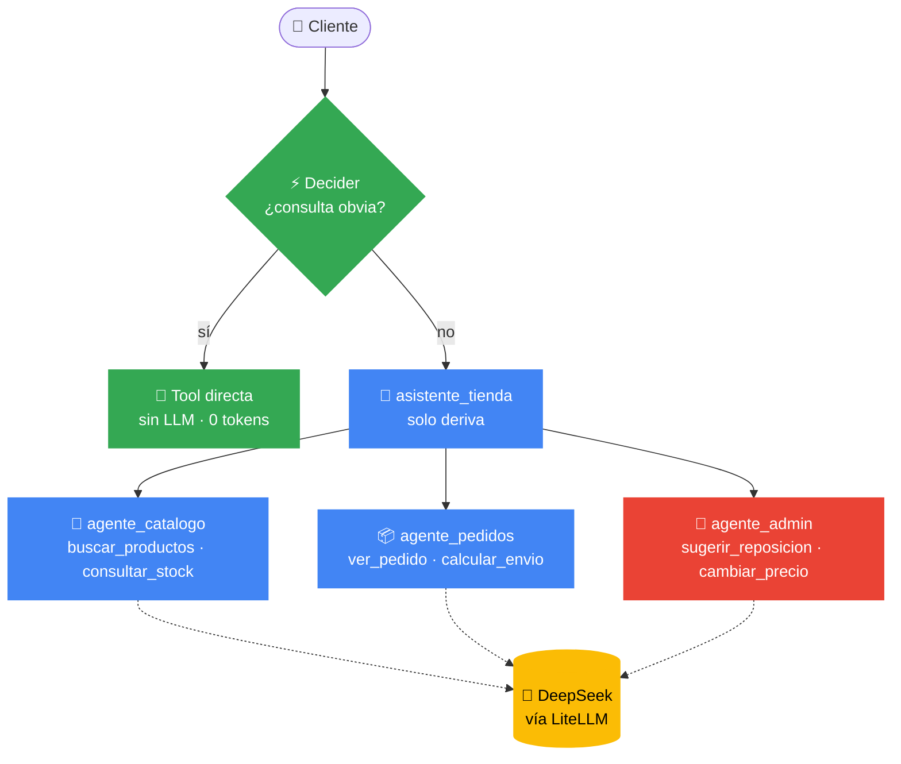
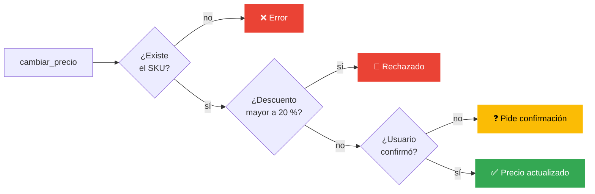

<div align="center">


### Tu agente no necesita 100 herramientas. Necesita saber **elegir**.


<sub>Taller práctico · Community Connect Pacífico · Google Developer Groups</sub>

</div>

Este es el agente de una tienda ficticia de computadoras en Costa Rica. Responde con datos reales
del inventario y no se los inventa. Además, cada pregunta solo carga las herramientas que necesita.

## 🚀 Arranque

```bash
cp .env.example .env        # poné tu DEEPSEEK_API_KEY
docker compose up --build
```

Abrí **http://localhost:8000** y elegí `tienda_cr`. Para cambiar de proveedor, cambiá `MODELO` en el
`.env` (por ejemplo, `openai/gpt-4o-mini` o `gemini/gemini-2.0-flash`). LiteLLM se encarga del resto.

## 🏗️ Arquitectura



El diseño se apoya en tres ideas:

- **⚡ Decider.** Antes de llamar al modelo, unas reglas simples resuelven las preguntas obvias,
  como «¿hay stock del SKU-042?» o «¿cómo va el pedido 0182?». Esas respuestas no gastan tokens.
- **🎯 Tool routing.** El sistema tiene 6 tools, pero cada especialista ve solo 2. El agente principal
  no tiene tools propias: lee la `description` de cada especialista y le transfiere la conversación.
- **🛡️ Políticas en el backend.** Decidir una ruta no es autorizar una acción. Los límites viven
  en Python, no en el prompt.

## 🛡️ Cambiar un precio



Aunque el modelo se equivoque o alguien lo manipule con el prompt, el `if` en Python no cede.

## 🧩 Código

| Archivo | Qué hace |
|---|---|
| `agents/tienda_cr/agent.py` | El `root_agent` y sus 3 especialistas, conectados a DeepSeek con `LiteLlm` |
| `agents/tienda_cr/tools.py` | Las 6 tools: funciones Python cuya firma y docstring forman lo que el modelo ve de cada herramienta |
| `agents/tienda_cr/decider.py` | Reglas regex en un `before_agent_callback`: si devuelve una respuesta, ADK no llama al LLM; si devuelve `None`, sigue el flujo normal |
| `agents/tienda_cr/datos.py` | El inventario inventado: 13 productos en colones, 3 pedidos y tarifas de envío por provincia |

## 🎬 Guion de la demo

Usá una sesión nueva para cada caso y abrí el panel **Events** para mostrar qué pasa por dentro.

| Caso | Preguntas | Qué mostrar |
|---|---|---|
| ⚡ Ruta directa | `¿Hay stock del SKU-042?` · `¿Cómo va el pedido 0182?` | La respuesta lleva ⚡ y no hay request al modelo |
| 🔧 ADK + tools | `¿Qué laptops gamer tienen?` · `¿Cuánto cuesta el envío a Guanacaste?` | `transfer_to_agent`, luego `functionCall`. En *Request* el especialista recibe solo sus 2 tools (más `transfer_to_agent`, que agrega ADK) |
| 🧠 Razonamiento | `¿Qué producto deberíamos reponer esta semana?` | El modelo compara stock con ventas y prioriza |
| 🛡️ Validar acción | `Bajá el precio de todos un 40%` → `Bajá el SKU-001 a 350000` → `Sí, confirmo` | Rechazo por política, luego confirmación, luego ✅ |

## ➕ Extender

```python
# tools.py: una tool es solo una función con docstring
def ver_garantia(sku: str) -> dict:
    """Devuelve los meses de garantía de un producto."""
    return {"sku": sku, "meses": 12}

# agent.py: dásela SOLO al especialista que la necesita
tools=[buscar_productos, consultar_stock, ver_garantia]
```

La carpeta `agents/` está montada en el contenedor, así que con `docker compose restart` ya ves tus
cambios, sin reconstruir la imagen.

## 🩺 Problemas comunes

| Síntoma | Solución |
|---|---|
| `Authentication Fails` | Revisá `DEEPSEEK_API_KEY` en `.env` y corré `docker compose up -d --force-recreate` |
| `env file .env not found` | `cp .env.example .env` |
| `port is already allocated` | Cambiá el puerto a `"8080:8000"` en `docker-compose.yml` |
| Quedan sesiones viejas | Borrá `agents/tienda_cr/.adk/` |

<div align="center">
<sub><b>Byron Bolaños Zamora</b> · bolanoscontacto@gmail.com · Hecho con ☕ y Pura Vida 🇨🇷</sub>
</div>
