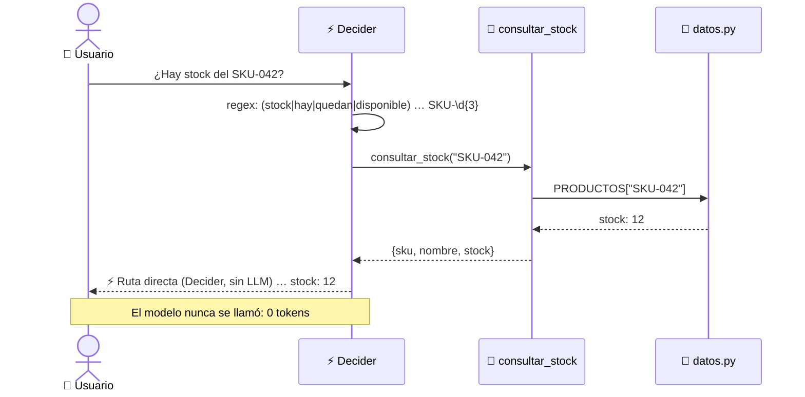
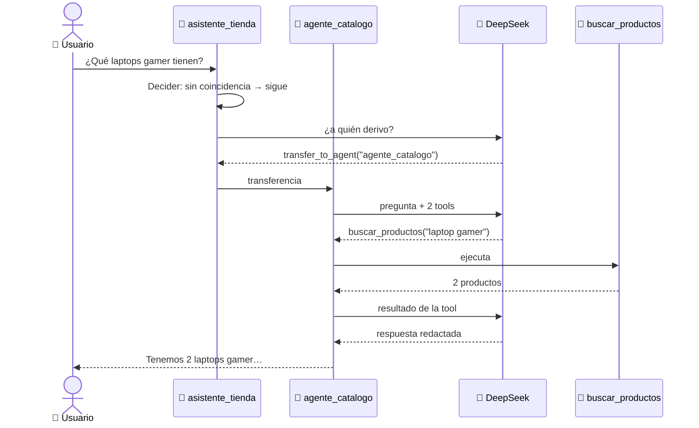

<div align="center">

```
 ____                __     ___     _         _____         _
|  _ \ _   _ _ __ __ \ \   / (_) __| | __ _  |_   _|__  ___| |__
| |_) | | | | '__/ _` \ \ / /| |/ _` |/ _` |   | |/ _ \/ __| '_ \
|  __/| |_| | | | (_| |\ V / | | (_| | (_| |   | |  __/ (__| | | |
|_|    \__,_|_|  \__,_| \_/  |_|\__,_|\__,_|   |_|\___|\___|_| |_|

        🖥️  Agente de e-commerce · Costa Rica 🇨🇷 · Google ADK
```

### Tu agente no necesita 100 herramientas.<br>Necesita saber **elegir**.

`Google ADK` · `LiteLLM` · `DeepSeek` · `Python 3.12` · `Docker`

*Taller práctico · Community Connect Pacífico · Google Developer Groups*

</div>

---

## 📑 Contenido

1. [¿Qué es esto?](#-qué-es-esto)
2. [Arranque en 30 segundos](#-arranque-en-30-segundos)
3. [Arquitectura](#️-arquitectura)
4. [Las tres rutas](#-las-tres-rutas)
5. [Recorrido de una solicitud](#-recorrido-de-una-solicitud)
6. [Las piezas, archivo por archivo](#-las-piezas-archivo-por-archivo)
7. [Datos inventados](#-datos-inventados)
8. [Guion de la demo](#-guion-de-la-demo)
9. [Cómo extenderlo](#-cómo-extenderlo)
10. [Problemas comunes](#-problemas-comunes)

---

## 🤔 ¿Qué es esto?

Un cliente pregunta: **«¿Tienen este producto?»**. La respuesta no está en el modelo, está en el
inventario. Este proyecto muestra cómo un agente de IA **consulta** en vez de **inventar**, y cómo
escala sin que cada pregunta cargue con todas las herramientas del sistema.

```
   CHAT SIN HERRAMIENTAS                     AGENTE CON HERRAMIENTAS
  ┌──────────────────────┐                ┌──────────────────────────────┐
  │ "¿Hay audífonos?"    │                │ "¿Hay audífonos?"            │
  │          │           │                │          │                   │
  │          ▼           │                │          ▼                   │
  │   🤖 "Creo que sí…"  │                │   🤖 consultar_stock(SKU-042)│
  │   (adivina)          │                │          │                   │
  └──────────────────────┘                │          ▼                   │
                                          │   📦 12 unidades (dato real) │
                                          └──────────────────────────────┘
```

Un agente tiene **cuatro ingredientes**:

```
  ┌───────────┐   ┌──────────────┐   ┌───────────┐   ┌──────────────┐
  │ 🧠 MODELO │ + │ 📜 INSTRUCC. │ + │ 📚 CONTEXTO│ + │ 🔧 TOOLS     │
  │ DeepSeek  │   │ rol y límites│   │ sesión    │   │ funciones    │
  │ vía       │   │ de cada      │   │ historial │   │ Python       │
  │ LiteLLM   │   │ agente       │   │ de chat   │   │ normales     │
  └───────────┘   └──────────────┘   └───────────┘   └──────────────┘
```

---

## 🚀 Arranque en 30 segundos

**Requisitos:** Docker con Compose y una API key de [DeepSeek](https://platform.deepseek.com).

```bash
# 1. Configurá tu API key
cp .env.example .env
nano .env                    # DEEPSEEK_API_KEY=sk-...

# 2. Levantá todo
docker compose up --build

# 3. Abrí el navegador
#    http://localhost:8000  →  seleccioná "tienda_cr"
```

```
  ┌──────────────────────────────────────────────────────────────┐
  │  ● ● ●   localhost:8000/dev-ui/?app=tienda_cr                │
  ├──────────────────────┬───────────────────────────────────────┤
  │  Events · Trace      │                                       │
  │                      │        ┌─────────────────────────┐    │
  │   ┌──────────────┐   │        │ ¿Qué laptops gamer hay? │    │
  │   │asistente_    │   │        └─────────────────────────┘    │
  │   │tienda        │──┐│  🤖 ⚡ transfer_to_agent               │
  │   └──────────────┘  ││  🤖 ✓ buscar_productos                 │
  │     ┌───────────────┘│  🤖 Tenemos 2 laptops gamer: …         │
  │     ▼                │                                       │
  │   ┌──────────────┐   │   ┌─────────────────────────────┐     │
  │   │agente_       │   │   │ Type a message…             │     │
  │   │catalogo      │   │   └─────────────────────────────┘     │
  │   └──────────────┘   │                                       │
  └──────────────────────┴───────────────────────────────────────┘
```

> La interfaz es **ADK Web**: a la izquierda ves cada evento, el request/response al modelo y el
> grafo de agentes y tools; a la derecha, el chat.

### Variables de entorno (`.env`)

| Variable           | Ejemplo                  | Para qué                                        |
|--------------------|--------------------------|-------------------------------------------------|
| `DEEPSEEK_API_KEY` | `sk-xxxxxxxx`            | LiteLLM la lee automáticamente para DeepSeek    |
| `MODELO`           | `deepseek/deepseek-chat` | Modelo en formato LiteLLM `proveedor/modelo`    |

> 💡 Como es LiteLLM, cambiar de proveedor es cambiar `MODELO` (y su key):
> `openai/gpt-4o-mini`, `anthropic/claude-...`, `gemini/gemini-2.0-flash`, `ollama/llama3`…

---

## 🏗️ Arquitectura

```
                         👤 Usuario
                            │  "¿Hay stock del SKU-042?"
                            ▼
   ╔════════════════════════════════════════════════════════════════════╗
   ║  🐳 Docker · adk web :8000                                         ║
   ║                                                                    ║
   ║   ┌────────────────────────────────────────────────────────────┐   ║
   ║   │ ⚡ DECIDER  (before_agent_callback · reglas regex)          │   ║
   ║   │    ¿La consulta es obvia y trae parámetros claros?         │   ║
   ║   └──────────────┬──────────────────────────────┬──────────────┘   ║
   ║            SÍ    │                              │   NO             ║
   ║                  ▼                              ▼                  ║
   ║   ┌──────────────────────────┐   ┌──────────────────────────────┐  ║
   ║   │ RUTA DIRECTA             │   │ 🤖 asistente_tienda (root)   │  ║
   ║   │ llama la tool en Python  │   │    0 tools propias           │  ║
   ║   │ 0 tokens · ~ms           │   │    solo decide a quién       │  ║
   ║   └────────────┬─────────────┘   │    transferir                │  ║
   ║                │                 └──────┬─────────┬─────────┬───┘  ║
   ║                │                        │         │         │      ║
   ║                │            ┌───────────┘         │         └────────────┐
   ║                │            ▼                     ▼                      ▼
   ║                │   ┌─────────────────┐  ┌─────────────────┐  ┌─────────────────┐
   ║                │   │ 🛒 catalogo     │  │ 📦 pedidos      │  │ 🔐 admin        │
   ║                │   ├─────────────────┤  ├─────────────────┤  ├─────────────────┤
   ║                │   │ buscar_productos│  │ ver_pedido      │  │ sugerir_        │
   ║                │   │ consultar_stock │  │ calcular_envio  │  │   reposicion    │
   ║                │   │                 │  │                 │  │ cambiar_precio🛡│
   ║                │   └────────┬────────┘  └────────┬────────┘  └────────┬────────┘
   ║                │            └────────────┬───────┴────────────────────┘
   ║                │                         ▼
   ║                │              ┌─────────────────────┐
   ║                │              │ 🧠 LiteLLM          │──────► ☁️  DeepSeek API
   ║                │              └─────────────────────┘
   ║                ▼                         ▼
   ║          ┌──────────────────────────────────────┐
   ║          │ 💾 datos.py  (inventario en memoria) │
   ║          └──────────────────────────────────────┘
   ╚════════════════════════════════════════════════════════════════════╝
```

### 🎯 Tool routing: 6 tools en el sistema, 2 por agente

El sistema tiene **6** herramientas, pero ningún agente las ve todas. Cada especialista recibe solo
las suyas, así el prompt que llega al modelo es más corto, más barato y con menos confusión.

```
   SIN ROUTING                              CON ROUTING (este proyecto)
   ───────────                              ──────────────────────────
   🤖 un agente                             🤖 root ─► 🛒 catalogo  [🔧🔧]
      [🔧🔧🔧🔧🔧🔧]                                 ─► 📦 pedidos   [🔧🔧]
      todas las descripciones                      ─► 🔐 admin     [🔧🔧]
      en cada llamada
                                            cada llamada carga 2 (+ transfer), no 6
   Con 100 tools…  [🔧 × 100] 😵             Con 100 tools…  [🔧🔧🔧] 😎
```

> 📌 Con 6 tools la diferencia es pequeña; el punto es el **patrón**: así es como crece a 100
> sin que cada pregunta pague el costo de las 100.

---

## 🛣️ Las tres rutas

```
                      ┌──────────────────────┐
                      │   Solicitud entrante │
                      └──────────┬───────────┘
                                 ▼
                         ┌───────────────┐
                         │   DECIDER     │
                         └───┬───┬───┬───┘
              ┌──────────────┘   │   └──────────────┐
              ▼                  ▼                  ▼
   ┌────────────────────┐ ┌─────────────────┐ ┌──────────────────────┐
   │ 01 RESOLVER DIRECTO│ │ 02 ENVIAR A ADK │ │ 03 VALIDAR ACCIÓN    │
   ├────────────────────┤ ├─────────────────┤ ├──────────────────────┤
   │ «¿Hay stock del    │ │ «¿Qué debería   │ │ «Bajá el precio del  │
   │   SKU-042?»        │ │   reponer?»     │ │   SKU-001»           │
   │                    │ │                 │ │                      │
   │ regex → tool       │ │ LLM razona y    │ │ LLM propone, el      │
   │ sin LLM            │ │ elige tools     │ │ BACKEND decide:      │
   │                    │ │                 │ │ límites + confirmar  │
   │ ⚡ 0 tokens        │ │ 🧠 tokens       │ │ 🛡️ seguro            │
   └────────────────────┘ └─────────────────┘ └──────────────────────┘
```

| Ruta | Ejemplo | Quién responde | ¿Usa LLM? |
|---|---|---|---|
| **01 Directa** | `¿Hay stock del SKU-042?` · `¿Cómo va el pedido #0182?` | `decider.py` | ❌ |
| **02 ADK** | `¿Qué laptops gamer tienen?` · `¿Qué deberíamos reponer?` | sub-agente + tools | ✅ |
| **03 Validar** | `Bajá el SKU-001 a 350000` | `agente_admin` + reglas en `cambiar_precio` | ✅ + 🛡️ |

> ⚠️ **Decidir una ruta no es autorizar una acción.** El Decider solo elige el camino; los
> permisos y límites viven en el backend (`tools.py`), nunca en el prompt.

---

## 🔍 Recorrido de una solicitud

### Caso A — Ruta directa (sin LLM)



### Caso B — Razonamiento con ADK



### Caso C — Acción sensible con política en backend

```
  👤 "Bajá el precio de todos los productos un 40%"
        │
        ▼
  🔐 agente_admin ── instrucción: "nunca cambiés precios masivamente"
        │
        ▼  (aunque el modelo lo intentara…)
  🔧 cambiar_precio(sku, nuevo_precio)
        │
        ├── ¿existe el SKU? ──────────── NO ──► ❌ error
        │
        ├── ¿descuento > 20 %? ───────── SÍ ──► 🚫 rechazado (precio mínimo ₡…)
        │
        ├── ¿confirmado=True? ────────── NO ──► ❓ "¿Confirmás cambiar … ?"
        │                                          │
        │                       👤 "Sí, confirmo" ─┘
        ▼
  ✅ precio actualizado
```

Dos capas de protección: la **instrucción** guía al modelo, pero la que manda es la **función**.
Aunque el modelo se equivoque o lo manipulen con el prompt, el `if` en Python no cede.

---

## 🧩 Las piezas, archivo por archivo

```
Taller-Google-ADK/
├── 🐳 docker-compose.yml   ← un servicio, puerto 8000, monta ./agents en vivo
├── 🐳 Dockerfile           ← python:3.12-slim + `adk web`
├── 📦 requirements.txt     ← google-adk · litellm · mcp
├── 🔑 .env.example         ← plantilla de DEEPSEEK_API_KEY y MODELO
└── agents/
    └── tienda_cr/          ← cada carpeta aquí = una app en ADK Web
        ├── __init__.py     ← expone el módulo agent
        ├── agent.py        ← 🤖 root_agent + 3 sub-agentes
        ├── decider.py      ← ⚡ reglas para la ruta directa
        ├── tools.py        ← 🔧 las 6 funciones (+ políticas)
        └── datos.py        ← 💾 inventario, pedidos y envíos
```

### 🤖 `agent.py`: los agentes

```python
modelo = LiteLlm(model=os.getenv("MODELO", "deepseek/deepseek-chat"))

agente_catalogo = Agent(
    name="agente_catalogo",
    model=modelo,
    description="Busca productos, precios y stock…",   # ← el root lee esto para derivar
    instruction=f"Sos el experto en catálogo… {ESTILO}",
    tools=[buscar_productos, consultar_stock],          # ← solo 2 tools
    before_agent_callback=decider,                      # ← ruta directa
)
...
root_agent = Agent(..., sub_agents=[agente_catalogo, agente_pedidos, agente_admin])
```

- **`description`** es clave: el agente principal la usa para decidir a quién transferir.
- **`sub_agents`** hace que ADK le dé al root la tool `transfer_to_agent` automáticamente.
- **`root_agent`** es el nombre que `adk web` busca para cargar la app.

### 🔧 `tools.py`: una tool es una función

ADK convierte **la firma y el docstring** en la definición que ve el modelo:

```python
def consultar_stock(sku: str) -> dict:
    """Devuelve cuántas unidades quedan de un producto según su SKU (ej: 'SKU-042')."""
```

```
            lo que escribís                          lo que ve el modelo
   ┌─────────────────────────────┐          ┌──────────────────────────────────┐
   │ def consultar_stock(        │          │ {                                │
   │     sku: str                │   ADK    │   "name": "consultar_stock",     │
   │ ) -> dict:                  │  ──────► │   "description": "Devuelve…",    │
   │   """Devuelve cuántas…"""   │          │   "parameters": {                │
   │                             │          │     "sku": {"type": "string"}    │
   │                             │          │   }                              │
   └─────────────────────────────┘          └──────────────────────────────────┘
```

| Tool | Agente | Entrada | Salida |
|---|---|---|---|
| `buscar_productos` | 🛒 catálogo | `"gamer"` | lista de productos con precio y stock |
| `consultar_stock`  | 🛒 catálogo | `"SKU-042"` | `stock: 12` |
| `ver_pedido`       | 📦 pedidos  | `"0182"` | `estado: en camino` |
| `calcular_envio`   | 📦 pedidos  | `"Guanacaste"` | `₡5 500 · 3 días` |
| `sugerir_reposicion` | 🔐 admin  | — | productos con stock < ventas de la semana |
| `cambiar_precio` 🛡️ | 🔐 admin  | `"SKU-001", 350000` | pide confirmación / rechaza / aplica |

### ⚡ `decider.py`: el selector de ruta

```python
REGLAS = [
    (re.compile(r"\b(stock|quedan|hay|disponible)\b.*\b(SKU-\d{3})\b", re.I), consultar_stock),
    (re.compile(r"\bpedido\s*#?(\d{4})\b", re.I), ver_pedido),
]
```

Corre como **`before_agent_callback`**: ADK lo ejecuta antes de llamar al modelo.

```
   before_agent_callback(ctx)
          │
          ├── devuelve types.Content ──► ADK usa eso como respuesta y NO llama al LLM
          │
          └── devuelve None ───────────► ADK sigue normal: modelo + tools
```

Si la tool devuelve un error (por ejemplo, un SKU que no existe), el Decider **se abstiene** y deja
que el agente lo maneje. *Ante la duda, no adivina: escala.*

> 🪜 **Construcción progresiva**: hoy son reglas. Si no alcanzan, el siguiente escalón es un
> clasificador local, y solo después un fine-tuning. *Empezá pequeño.*

---

## 💾 Datos inventados

Todo vive en memoria (`datos.py`), se reinicia al reiniciar el contenedor y los precios están en colones.

### 🖥️ Catálogo

| SKU | Producto | Categoría | Precio | Stock |
|---|---|---|---:|---:|
| SKU-001 | Laptop Lenovo IdeaPad 3 Ryzen 5 16GB/512GB | laptop | ₡389 000 | 14 |
| SKU-002 | Laptop HP Victus 15 RTX 4050 i5 | laptop gamer | ₡649 000 | 6 |
| SKU-003 | MacBook Air M3 13" 16GB/256GB | laptop | ₡739 000 | 3 |
| SKU-004 | Laptop ASUS ROG Strix G16 RTX 4070 i9 | laptop gamer | ₡1 189 000 | **0** |
| SKU-005 | Laptop Acer Aspire 5 i3 8GB/256GB | laptop | ₡279 000 | 22 |
| SKU-010 | PC Escritorio Dell OptiPlex i5 16GB/512GB | escritorio | ₡459 000 | 9 |
| SKU-011 | PC Gamer Pura Vida Ryzen 7 RTX 4060 Ti | escritorio gamer | ₡899 000 | 4 |
| SKU-012 | Mac mini M4 16GB/512GB | escritorio | ₡529 000 | 2 |
| SKU-020 | Monitor LG 27" IPS 144Hz | monitor | ₡159 000 | 18 |
| SKU-021 | Monitor Samsung Odyssey G5 32" curvo | monitor | ₡219 000 | 1 |
| SKU-030 | Teclado mecánico Redragon Kumara | accesorio | ₡24 900 | 40 |
| SKU-031 | Mouse Logitech MX Master 3S | accesorio | ₡59 900 | 12 |
| SKU-042 | Audífonos inalámbricos Sony WH-1000XM5 | accesorio | ₡189 000 | 12 |

### 📦 Pedidos

| # | Cliente | Estado | Provincia | Entrega |
|---|---|---|---|---|
| 0182 | María Jiménez | 🚚 en camino | Puntarenas | 2026-10-22 |
| 0183 | Carlos Vargas | 📦 preparando | San José | 2026-10-21 |
| 0184 | Ana Solís | ✅ entregado | Guanacaste | 2026-10-18 |

### 🗺️ Envíos

```
                    🇨🇷  COSTA RICA · TARIFAS DE ENVÍO

        Guanacaste ₡5 500 · 3d
               ●
                 ╲        Alajuela ₡4 000 · 1d
                  ╲          ●     Heredia ₡3 500 · 1d
                   ╲          ╲   ●
     Puntarenas     ●──────────●─●───────────● Limón ₡5 500 · 3d
     ₡5 500 · 3d            San José    ╲
                            ₡3 500 · 1d  ● Cartago ₡4 000 · 1d
```

---

## 🎬 Guion de la demo

Pegá estas preguntas en orden en ADK Web. Abrí el panel **Events** para mostrar qué pasa por dentro.

```
 ┌─ CASO 01 · RUTA DIRECTA ───────────────────────────────────────────┐
 │  › ¿Hay stock del SKU-042?                                         │
 │  › ¿Cómo va el pedido #0182?                                       │
 │  👀 Mostrá: respuesta con ⚡, sin request al modelo, 0 tokens       │
 └────────────────────────────────────────────────────────────────────┘
 ┌─ CASO 02 · ADK + TOOLS ────────────────────────────────────────────┐
 │  › ¿Qué laptops gamer tienen?                                      │
 │  › ¿Cuánto cuesta el envío a Guanacaste?                           │
 │  👀 Mostrá: transfer_to_agent → sub-agente → functionCall          │
 │     En "Request": solo sus 2 tools (+ transfer_to_agent)           │
 └────────────────────────────────────────────────────────────────────┘
 ┌─ CASO 03 · RAZONAMIENTO ───────────────────────────────────────────┐
 │  › ¿Qué producto deberíamos reponer esta semana?                   │
 │  👀 Mostrá: el LLM interpreta stock vs. ventas y prioriza          │
 └────────────────────────────────────────────────────────────────────┘
 ┌─ CASO 04 · VALIDAR ACCIÓN ─────────────────────────────────────────┐
 │  › Bajá el precio de todos los productos un 40%                    │
 │  › Ok, entonces bajá el SKU-001 a 350000                           │
 │  › Sí, confirmo                                                    │
 │  👀 Mostrá: rechazo por política → pedido de confirmación → ✅      │
 └────────────────────────────────────────────────────────────────────┘
```

> 💡 Tip: usá **una sesión nueva** para cada caso, así el grafo de eventos queda limpio.

---

## 🛠️ Cómo extenderlo

Gracias al volumen `./agents:/app/agents`, editás el código en tu máquina y basta con
`docker compose restart` para verlo, sin rebuild.

### ➕ Agregar una tool

```python
# tools.py
def ver_garantia(sku: str) -> dict:
    """Devuelve los meses de garantía de un producto."""
    return {"sku": sku, "meses": 12}
```

```python
# agent.py → agregala SOLO al agente que la necesita
tools=[buscar_productos, consultar_stock, ver_garantia],
```

### ➕ Agregar una regla al Decider

```python
# decider.py
(re.compile(r"\benv[ií]o\b.*\b(guanacaste|lim[oó]n|san jos[eé])\b", re.I), calcular_envio),
```

### ➕ Agregar un especialista

```python
agente_soporte = Agent(
    name="agente_soporte",
    model=modelo,
    description="Garantías, devoluciones y soporte técnico.",
    instruction=f"Atendés soporte de PuraVida Tech. {ESTILO}",
    tools=[ver_garantia],
)
root_agent = Agent(..., sub_agents=[..., agente_soporte])
```

---

## 🩺 Problemas comunes

| Síntoma | Causa | Solución |
|---|---|---|
| `Authentication Fails, Your api key … is invalid` | Key inválida o de ejemplo | Revisá `DEEPSEEK_API_KEY` en `.env` y reiniciá con `docker compose up -d --force-recreate` |
| `No module named 'mcp'` | Esta versión de LiteLLM lo necesita para DeepSeek | Ya está en `requirements.txt`; hacé `--build` |
| `env file .env not found` | Falta el `.env` | `cp .env.example .env` |
| `port is already allocated` | El 8000 está ocupado | Cambiá a `"8080:8000"` en `docker-compose.yml` |
| Warning `binding to a non-loopback address` | ADK avisa que no hay autenticación | Normal en local; no lo expongás a internet |
| Las sesiones viejas siguen ahí | ADK guarda en `agents/tienda_cr/.adk/session.db` | Borrá esa carpeta (está en `.gitignore`) |

---

<div align="center">

```
  ┌─────────────────────────────────────────────────────────────┐
  │   Arquitectura escalable =                                  │
  │       capacidades disponibles                               │
  │     + contexto relevante                                    │
  │     + decisiones evaluables                                 │
  │     + controles necesarios                                  │
  └─────────────────────────────────────────────────────────────┘
```

**Byron Bolaños Zamora** · bolanoscontacto@gmail.com

*Hecho con ☕ y Pura Vida 🇨🇷*

</div>
